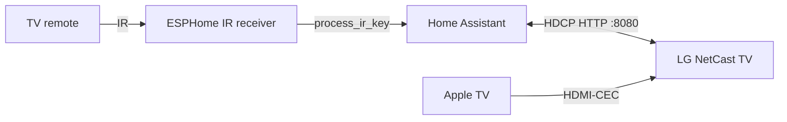

# Documentation

Start with the [main README](../README.md) if you are installing the integration
for the first time.

## Guides

| Guide | Audience | What it covers |
|---|---|---|
| [Configuration](configuration.md) | Users | Options, power-on methods, Apple TV/CEC, input sources, IR tracking |
| [IR receiver](ir-receiver.md) | Users with ESPHome | Hardware, wiring, ESPHome YAML, code capture, debounce, testing |
| [State and dashboard](state-and-dashboard.md) | Users | Attributes, cards, templates, why only “Encendido” is visible |
| [Troubleshooting](troubleshooting.md) | Users | Symptom/cause/fix tables, logs, diagnostics |
| [FAQ](faq.md) | Users | Short answers to common questions |
| [Protocol](protocol.md) | Developers | Endpoints, XML, state queries, power-on limitation |
| [Key codes](keycodes.md) | Developers | Tested key matrix and direct-input codes |

## How the pieces connect

- The integration talks to the TV over local HTTP.
- The Apple TV can wake the TV through HDMI-CEC if the TV is on the Apple TV
  input.
- The ESPHome receiver only reports keys to Home Assistant; the TV already
  received the IR command.
- No cloud service is involved.

## Glossary

| Term | Meaning |
|---|---|
| HDCP | The LG HTTP remote-control protocol used by this integration |
| Pairing key | Six-character key stored in the Home Assistant config entry |
| Session | Short-lived ID returned by the TV after pairing; kept in memory |
| NetCast 2.0 | LG TV platform from 2011 |
| SIMPLINK / HDMI-CEC | HDMI control protocol used for power and input switching |
| IR receiver | 38 kHz sensor connected to an ESP board |
| ESPHome | Firmware used to connect the IR receiver to Home Assistant |
| Source | A configured input name such as `HDMI1` |
| UI mode | TV UI context such as `VolCh` or `TouchPad` |
| Coordinator | Background poller for power/channel/UI mode |

## Project

- [Security policy](../SECURITY.md)
- [Contributing](../CONTRIBUTING.md)
- [Project rules](../AGENTS.md)

## Documentation style

The guides are written task-first:

- “What you need” before each task.
- Numbered steps.
- A result or check after each important step.
- Code blocks that can be copied.
- A troubleshooting section for each device or workflow.

If a guide is unclear, open an issue with the exact step and what you expected
to see. Do not include a pairing key or session ID.
